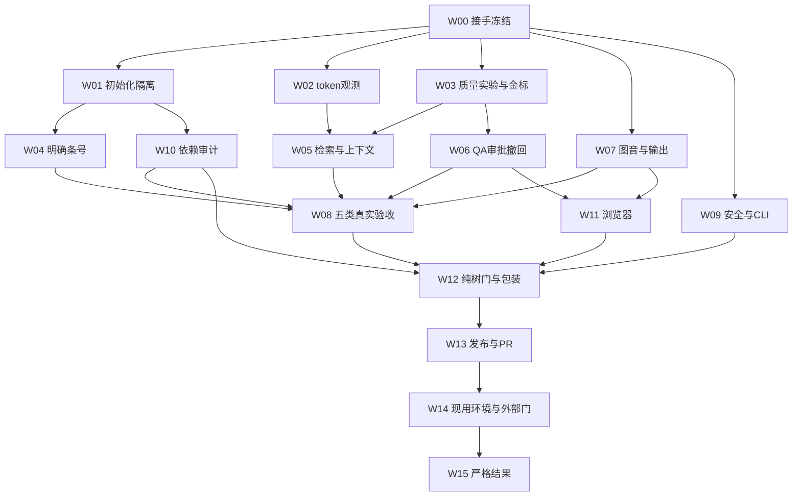

# 法智助手全范围修复与非部署收尾执行书（2026-10-15）Implementation Plan

> **For agentic workers:** 使用 `executing-plans` 逐任务推进；用户已允许需要时并行协助，派发时使用 `module-dispatch-new` 的责任、验收、集成契约。默认一个统筹助手、一个集成写入者；独立复核者不能是同一任务的实现者。步骤用复选框记录。用户要求的是先写书，本次编写不等于已经执行产品修复。

**Goal:** 覆盖全部交接待办、待决策与新诊断，完成可验证的修复、模型质量验收及非部署交付；严格区分“已写方案、已修、已验、已交付、发布条件齐备”。

**Architecture:** 保留现有 Fast Path、Agent、检索及前端架构，先恢复可观测和隔离能力，再修问题状态、证据选择、QA审批生命周期和多模态失败传播。保留一个候选真源；新增业务语义先对齐，不搭新的通用评测平台，不凭更换模型掩盖链路缺陷。

**Tech Stack:** 当前仓库 Python/FastAPI/SQLAlchemy/SQLite/Chroma/LangChain/BGE；Next.js/React/TypeScript/Vitest；Windows PowerShell 与既有 Linux CI/镜像目标。依赖精确闭包和解释器以执行前登记为准；不自动升级到最新版本。

## 0. 如何使用与授权优先级

本书整合原A–J执行书、D-1至D-56台账、评测T1–T8与2026-10-15新诊断。**“纳入范围”表示必须处理或交付明确阻塞，不表示待决策方案已经获批。** 当前会话用户的新指令最高；已有明确裁定沿用；历史事实不可改写。报告与台账冲突时按对象、日期、实际裁定和新证据消歧，不机械按章节后出现者覆盖。

### 0.0 2026-10-18生效补充：分阶段执行，全范围必做

本文件继续作为最终全范围执行书入口，W00–W15及原质量/发布/生产关口全部保留。当前状态先读[2026-10-18复核交接](C:/Users/33393/Desktop/ai-legal-helper/docs/handoff-full-scope-20261016.md)和[Owner决策记录](C:/Users/33393/Desktop/ai-legal-helper/docs/full-scope-decisions-20261018.md)，不能把本书历史“待裁”机械当作仍欠Owner回答。

Owner新增原话：「可以分阶段，但最终执行计划书里都要有」。因此W06明确承接W06-P0暂停自动批准前置及三阶段：C21-A候选选择、W06-B缓存及输出前复核、W06-C历史回答/摘要/查询改写/Agent记忆与派生QA来源追踪。阶段三是必做范围，不能另列成可无限延期的建议；完整步骤、责任写面和57项尚未执行控制见[分阶段执行方案](C:/Users/33393/Desktop/ai-legal-helper/docs/process-archive/superpowers/plans/2026-10-18-qa-selection-and-revocation-execution-plan.md)，总体依赖及终验补充见8.1，覆盖补漏、消歧与执行纪律见8.2–8.4。

允许独立阶段交付，不降低完整验收门；阶段一/二通过时，历史/摘要未闭仍报Partial/BLOCKED。具体旧未知来源输入策略在阶段三给可审示例后对齐，纳入计划不等于批准清空历史、读取真实会话、迁移实库或部署。补充前原书字节已保存在[版本基线](C:/Users/33393/Desktop/ai-legal-helper/reports/planning/qa-read-contract-20261018/full-book-before-phased-addendum.md)，旧review/RUN证据不回写。

### 0.1 固定入口与写书时快照

| 符号 | 完整路径或对象 | 用法 |
|---|---|---|
| M 主工作区 | `C:/Users/33393/Desktop/ai-legal-helper` | 保护他人成果，不能整树覆盖或把全部dirty当本任务 |
| C 既有候选 | `C:/Users/33393/Desktop/ai-legal-helper/.worktrees/nondeploy-closeout-20261010` | 写书时HEAD `a204725dac0571ce10d52994369bc7b2c7827d9b`，tracked干净；接手须重新核对 |
| R 旧运行根 | `C:/Users/33393/Desktop/fazhi-nondeploy-closeout-20261010-b4e7a2` | 历史报告/日志只读，新增执行记录另开新根 |
| E 评测根 | `C:/Users/33393/Desktop/answer-quality-eval-20261013` | 原题、gold、答案、评分和日志只读 |
| Q 本轮诊断 | `C:/Users/33393/Desktop/answer-quality-eval-20261013/quality-diagnosis-20261015` | `report.md`、`verification.json`、`design-and-curation.md`、`independent-review.md`、`next-experiments.md`、`manifest.json` |
| B 原执行书 | `C:/Users/33393/Desktop/ai-legal-helper/docs/process-archive/superpowers/plans/2026-10-10-non-deployment-release-closeout-execution-plan.md` | 原A–J义务及安全边界的来源，不直接重跑过期操作卡 |
| 主仓快照 | master `0b543960c7172ce1ffea57616952e4d5525190c4`；21项tracked修改 | 写书时观察，非要求其他会话永远保持该数量 |
| 发布快照 | `release/closeout-20261015=30dd7af0fdcf1c52c9fac3ccfcc1a1e57a26658a`；base `985d53e4ee81efc066cc6915abcba98954e7d408` | 与C分开；候选测试不能自动给发布快照背书 |
| 远端交付 | [PR #1](https://github.com/wjt-code-design/fazhi-assistant/pull/1) | 上次核实Open且无review；当前状态执行时重取，不能把本句当实时查询 |

后文生产文件路径均相对**执行时登记的候选C**，例如`backend/retrieval.py`；它们不是让你去修改主仓M。新增测试文件均标“新增”，不存在不是历史证据缺失。若另开隔离工作树，登记新C和精确ref，禁止默认从master起步丢掉a204725已有成果。

### 0.2 必读资料与冲突处理

- `R/reports/work-report.md`、`R/reports/review-20261015.md`、`R/reports/results.md`、`R/reports/release-push-20261015.md`。
- `R/reports/decisions-needed-20261010.md`：读最新补记；其中“未推送”“迁移未落地”“D-53待加限定”等旧段已有后续状态，不作为当前待办。
- `E/19题总账-v1.md`及三批判据表；交签正文锚三批`4552a9070a9b9774`、二批`56802fbfa1712f40`仅作已核历史锚，执行前按原行段定义复算。
- `E/tickets/dispatch-T1-subquestion-retrieval-20261015.md`、`E/tickets/dispatch-T2-asr-endpoint-and-markdown-20261015.md`为旧票，本书明确纠正其失效假设。
- 用户全局`C:/Users/33393/AGENTS.md`、沿目录AGENTS、候选`CONTRIBUTING.md`、`docs/code-review-standard.md`。用户当前授权优先于skill默认流程；禁止弹窗，确认用中文纯文本grilling一次一个问题。

### 0.3 沿用的裁定与硬边界

| 项目 | 执行规则 |
|---|---|
| 已完成事项 | D-9/D-10、迁移D-3/D-29、D-14、D-22/D-28、D-33负例、D-34等先对账，不重做；最终版本仍须受影响回归 |
| 文本模型 | D-47：`LongCat-2.5-Preview`走流式，不设token/金额闸，不重复请求预算批准；固定病例/有限轮次、超时、实际发送计数仍有效 |
| 其他模型资源 | 不把D-47扩成所有供应商无限授权。D-41记录现役账号及100元边界；与原B和后续裁定逐能力核实适用范围/累计用量。不能确认时只暂停相关外发，提出具体缺口，文本授权及离线工作继续 |
| 既有模型选择 | 文本沿D-47；视觉/语音的Owner指定模型列入W07。Agent是否共享文本模型须核可用能力与路由。供应商切换或增模型须先对齐 |
| D-51 | “下轮修”方向已裁；旧台账的入口与自动默认值归因有冲突，先核真实启动链。现有缺输入拒绝不能被重造；仅对已复现缺口按C05选具体加强方式 |
| D-53 | 限定句已写，补确认轮合法但不证明自动入合同态；新增自动路由行为另经C07 |
| D-55 | 副本及hook已有授权，先查原裁定的对象与共享影响；覆盖明确就执行。只问未覆盖的具体对象，不再整包索要许可 |
| 模型配置/凭据 | 仅从执行进程已配置变量读取所需值用于认证。禁止打开.env、历史备份找key；日志不输出值、片段、长度指纹、密钥摘要或完整配置。缺配置仅报变量名，请本机注入，不能让用户贴聊天 |
| 数据 | 允许本轮公开/合成样本和已确认归属的评测副本。禁止真实业务库、真实会话/上传件/媒体/配额库及其备份读写，包括为哈希而读取。实库恢复单独授权 |
| 发布 | 新修复默认停在本地交付/可审PR准备。原快照推送例外不覆盖新公开集合、旧历史或合并。新push/PR更新按已授权ref范围核定，合master仍按最新Owner裁定和门禁，不能先合解锁CI |
| 部署 | 不选购服务器、不运行现用compose、不重启生产容器、不切流/改域名TLS/开放公网、不迁移实库；生产平台前置纳入台账并由Owner决定 |
| 失败纪律 | 同命令失败先分析，完全相同最多再试一次；同bug三次修复未过必须质疑结构。发现结构性根因可更早重规划。不能降门槛、改gold、删测试或无限rerun救绿 |

旧工程T2要求“真人音频/Owner录音”和列密钥摘要，与原B的合成样本/不印摘要冲突：本书明确覆盖。使用预写文本的可辨识合成语音；纯音仅负控；样本不可生成则该腿BLOCKED。旧指纹记录保留原件，公开副本脱敏，不再复述。

## 1. 状态、责任及证据契约

状态统一为：`NOT_STARTED`、`READY`、`IN_PROGRESS`、`FIXED_PENDING_REVIEW`、`PASS`、`FAIL`、`BLOCKED_OWNER`、`BLOCKED_EXTERNAL`、`DEFERRED_BY_OWNER`。已派发、风险已登记、建议已写均不能替代PASS。`PASS`必须绑定精确源码tree、依赖闭包、数据/模型快照及可复算证据。

### 1.1 真实目标与分母

- 真实目标：回答对题、事实/数字/日期保真、结论有适用依据、缺依据显式说明、降级可见、不会把未验证答案反复传播。
- 代理指标：条文进top10、条号在库、HTTP200、QA命中、答案变长、测试数量。这些单列，不能当正确率。
- 原19题的校准/正式、A/B、判格/C0、人判分开；红格数不等于缺陷数。累计发送包含替换答案、失败、辅助/重试调用，保留答案对应次数不作账单。
- 机器复核分不是法律专业审签。跨版本适用等缺合格审查记录时法律门保持BLOCKED。

### 1.2 每票的输入、交付与回执

执行前落`task-contract.md`：任务ID、已确认选择、目标C/ref/tree、唯一写入文件、环境/数据绝对路径、消费者/生产者接口、依赖、预登记判据、允许外发、回退和停止条件。不存在的接口标为“拟新增，经本票定义”，不能在后续票假装已存在。

每票交付`report.md`、精确diff/文件摘要、`commands.jsonl`、原始日志、测试前失败证据/修后证据、未测项、依赖变化、人工/外部动作、下游影响。没有可安全复现的旧红就说明原因，不为证明红去碰真库。

回执模板（给所有助手）：

```text
任务ID / 实际C与HEAD / 起止时间：
授权来源与本票具体选择：
改动文件 / 输入输出契约变化：
症状、失败位置、根因置信度与证据字段：
先红命令+退出码 / 修后命令+退出码：
独立判据来源 / 阳性阴性控制：
真实与替身组件 / 实际发送与拒绝数：
源码/金标/原库保护核对：
尚未完成、未测及解除条件：
自审后状态 / 需要统筹复核的点：
```

## 2. 全范围追踪表

### 2.1 原A–J与本书任务

| 原范围 | 本书承接 | 本轮仍必须覆盖 |
|---|---|---|
| A 接手保护 | W00、W12 | 来源归属、dirty/索引、所有权、独立副本、无覆盖 |
| B 后端接收修复 | W01–W09、W12 | 已收成果不回退，新缺陷与API/存储/恢复回归 |
| C 依赖风险 | W10、W12 | 最终闭包、官方新审计、兼容、残余风险有效期 |
| D 浏览器 | W11 | 六状态徽章、上传键盘、响应式、能力门、取消/切会话 |
| E 信任/恢复 | W00、W12、W14 | 模型信任、合成备份恢复；实库独立门 |
| F 五类模型/法律 | W03、W07、W08 | 文本/rerank/Agent/图/音，独立gold和专业审签边界 |
| G 现用环境 | W14 | 实际归属、兼容版本、回退验证；容器重启不在本书授权内 |
| H 包装/安全/CI | W01、W09–W13 | 最终镜像/包、公开集合、凭据、有效CI |
| I Git/审查/合并 | W13 | 精确交付树、独立审查、当前head checks与Owner合并关口 |
| J 严格收尾 | W15 | J1–J6逐项、完整manifest、失败/阻塞与下一责任人 |

### 2.2 D-1至D-56完整索引

以下为接手归类，不是本书新验收结果。历史已完成的条目通过W00对账并按最终差异回归；发现不在实际交付树时重开对应票。

| 决策 | 当前理解 | 承接 |
|---|---|---|
| D-1 | 状态机解冻/DB-15已落地，保留 | W00/W12 |
| D-2 | Chroma历史风险接受有范围及失效条件，不等于今日安全/CI通过 | W10/C08 |
| D-3 | LangChain迁移已落地，最终闭包再验 | W10/W12 |
| D-4 | DB-19分类回落收窄已落地 | W00/W05/W12 |
| D-5 | 快照push/PR已做，凭据处置与新公开范围未自动解除 | W09/W13 |
| D-6 | 新环境已备好，现用切换未完成 | W14 |
| D-7 | 早期不跑模型已被后续F/D-41/D-47覆盖，不能继续当零调用授权 | W03/W08 |
| D-8 | category不摘；保留现有字段 | W05 |
| D-9 | DB-22拒答冷却分档已做 | W00/W07/W12 |
| D-10 | DB-23恢复409四档已做 | W00/W09/W12 |
| D-11 | 风险册已入候选，核公开副本 | W00/W10 |
| D-12 | 脱敏reports/tickets已有入库，不推全部原证据 | W13/W15 |
| D-13 | 五个前端文件已有hunk整合 | W00/W11 |
| D-14 | CLI写守卫已交付，不重造；D-36质量红仍在 | W00/W09/W08 |
| D-15 | DB-7技术降级白名单已做，禁止扩大为业务失败任意回退 | W09/W12 |
| D-16 | DB-10管理指标事件说明已做，真实读数面是管理员llm-status | W12/W15 |
| D-17 | 使用冻结题集，不擅自补种子库 | W03/W08/C10 |
| D-18 | DB-24注释/角色真源已修，别把死LLM_MODEL当路由配置 | W00/W07/W08 |
| D-19 | 文档ref方向已裁，快照例外不覆盖旧ref历史；给安全交付方案 | W13/C12 |
| D-20 | 历史整合与合master仍未闭合，冲突数须按当前两端重算 | W13 |
| D-21 | 盘上前端成果已提交整合，核字节归属 | W00/W11 |
| D-22 | 徽章类名purge修复/build:check已做，最终产物复验 | W11/W12 |
| D-23 | 取消与无响应占位已分档，保留断开信号语义 | W09/W11/W12 |
| D-24 | 分类探测失败按既有宽回落并留痕，不偷偷改窄 | W05/W12 |
| D-25 | 源下载fallback/probe已有，最终联合求解/镜像未因此通过 | W10/W12 |
| D-26 | 迁移独立会话安排历史已完成，勿重新派旧迁移 | W00 |
| D-27 | 独立复核要求沿用，新head还需独立review | W12/W13 |
| D-28 | 徽章AA与可区分性已修，浏览器按受影响面复验 | W11 |
| D-29 | 两份迁移diff已落地，不按旧“未落”重做 | W00/W10 |
| D-30 | 主仓其余未确认文档不自动收；本书为用户新明确要求的单一文件 | W00/W13 |
| D-31 | 409/取消文案已获整包落地，逐字过稿仍可选；改词不重裁分档 | W09/C11 |
| D-32 | 前端当场取消与历史占位保持两套语义 | W11 |
| D-33 | 越界防御保留，恢复负例已补，核最终回归 | W00/W09/W12 |
| D-34 | 响应归属/补偿已修，不能回到旧“仅待复现” | W00/W09/W11 |
| D-35 | 本机改密有完成记录；JWT/目标服务器失效动作按实际对象分列 | W09/W14/Owner |
| D-36 | verify_new_law原质量判据红并入F，不改尺子救绿 | W08 |
| D-37 | 既有前端format红已接受且不新增全仓门；受改文件遵规范 | W11/W12 |
| D-38 | dockerignore深层DB排除已修，最终镜像再验 | W12 |
| D-39 | 按用户非破坏性撤销会话尚无；保留票，是否本轮做需具体裁定 | W09/C06 |
| D-40 | 重置入口候选侧已改，不等于真账号/JWT已失效 | W00/W09 |
| D-41 | 其他真实能力资源/独立机器复核边界按适用裁定核定 | W08/C09 |
| D-42 | runbook终端前置已改，isatty产品守卫待处理 | W09/C06 |
| D-43 | 重置脚本显式目标库待处理，不能以默认.env目标执行 | W09/C06 |
| D-44 | 覆写事故已取证恢复，责任未定；以后纯树验收，保留事故材料 | W00/W12 |
| D-45 | 私有SDK接口与声明版本窗不一致，不能用注释当兼容证明 | W10/C08 |
| D-46 | 历史审计红不能被风险登记豁免；D-52之后取当前审计 | W01/W10/W13 |
| D-47 | LongCat流式、不算预算，沿用不再问 | W03/W08 |
| D-48 | 旧rerank鉴权阻塞已关闭，按需要重验有效性，不推广其他key可用 | W08 |
| D-49 | DashScope额度是历史外部条件，指定其他模型已有探针；按类分别验证 | W07/W08/C09 |
| D-50 | 明确条号被旁条顶替，需窄意图未命中契约及回归 | W04/C02 |
| D-51 | 下轮处理方向已定；旧自动默认值归因待核，当前缺输入拒绝不得破坏 | W09/C05 |
| D-52 | 产品导入初始化和测试隔离共同问题，非单纯“runner没外网” | W01/C01 |
| D-53 | 限定句已写，自动入合同态仍属独立需求 | W03/C07 |
| D-54 | 图片失败空串已确认；最终HTTP/SSE影响先复现再定 | W07/C04 |
| D-55 | 指定Chroma副本/hook已授权待核对象执行；诊断私有副本不顶替原交付 | W00/W12 |
| D-56 | CI/网络/key有效性是按需复测事实，不占Owner决策名额 | W08/W13 |

### 2.3 评测T编号和新增发现

“评测T2”是引用缺陷归并口径；“工程T2”是ASR/markdown票。回执必须带命名空间，不得只写T2。

| 事项 | 处理 |
|---|---|
| 评测T1 检索拆检票 | W05：先否证旧假设、检验融合容量；旧推荐不直接实现 |
| 评测T2 引用归D-50或单列 | C02：语义错误/证据选择与明确条号替代分别记录；Q17的563不能直接判模型编造 |
| 评测T3 Q13缺件/gold粒度 | C07/W03：转独立出题人；核真实格ID，旧文字P4/P5/P6与结果页不一致先对账 |
| 评测T4 markdown轮次 | C04/W07：明确输出规范与修复轮次，不能改评分尺隐藏 |
| 评测T5 判据复签 | W03：正文3处+口径2处，保留锚链并请求外部复签，不重签原题答案 |
| 评测T6 推送线 | W13：快照/PR已做，余下当前CI/review/合并/凭据另记 |
| 评测T7 多模态探针 | W07/W08：形状兼容不是入口正确，完成产品图/音链路 |
| 评测T8 凭据/JWT/默认口令 | W09、Owner动作，不把一次rerank换key当全部轮换 |
| N01 token观测None | W02；当前对象_client与旧观测client失配，支持真实对象及失败测量 |
| N02 Q17两轴不同丢失阶段 | W05；A未进采样池，B余弦第24，不能统一归因 |
| N03 场景补充563与QA完整prompt | W03/W05；本次prompt含563，历史完整prompt仍unknown |
| N04 拆检满k容量 | W05；主查询满额后补充被截，不能只加分割器 |
| N05 自动审批与撤回缺口 | W06；相似度未看答案，拒绝不撤QA，存量审核来源不可区分 |
| N06 评测旧仪器/报数限制 | W03/W15；38臂修订表征不是产品通过，累计调用与保留样本分列 |

## 3. 待决策关口（逐问，不把写书当批准）

统筹先完成可核事实、反例、最小方案与影响，再使用grilling中文纯文本一次问一项；已经回答的项直接登记，不反复问“是否继续”。表中含多个子项的行必须拆成子ID逐问，不能打包让用户一次批准。每项答复写`decisions.jsonl`：ID、用户原话、范围、时间、依赖票和边界。缺答只阻塞依赖它的实现，离线诊断和其他票继续。

| ID | 到此时只问的具体问题 | 推荐及影响 | 依赖 |
|---|---|---|---|
| C01 | D-52采用惰性初始化+显式集成缓存方案，还是只做缓存预置？ | 推荐前者；纯逻辑测试替身与真实集成分开，两条均需有效，不能只改import就报通过 | W01实现 |
| C02 | 对“解释明确某条原文”精确未命中时，是否显式说明本库未命中并阻止旁条冒充？引用缺陷按子类挂D-50还是另立？ | 推荐显式未命中，允许说明性旁引；检索/证据选择与主条号替代分别验，不要求所有答案只引一个条号 | W04/C02口径 |
| C03 | 是否暂停相似度自动approved，并把未核订存量QA退出直返及prompt注入？ | 推荐保留候选箱，存量先隔离不删；需审核来源/读取资格/撤回契约，行为与数据格式有影响 | W06写侧/读侧变化 |
| C04 | 图片失败采用可见错误还是明确降级声明？markdown规范按哪些内容允许保留，安排哪轮？ | 推荐失败可见、无空串冒充成功；保留法条书名号/编号及被允许的代码或数学内容。UI/API变化需前后端同一契约 | W07/W11 |
| C05 | 对已复现的首启口令缺口，选择拒绝显式公知值、一次性口令或首登强改哪种加强？ | 先核事实；实际`backend/seed_admin.py`已有缺ADMIN_PASSWORD拒绝和已有用户跳过，不能把这两项重造为修复。若无实际缺口关历史误报；若显式公知输入可用或外层注入默认，点名入口后再裁具体加强 | W09种子策略 |
| C06 | D-39精准撤销、D-42终端守卫、D-43显式库目标哪些在本轮落？ | 推荐先完成42/43的离线可验保护，39独立迁移票；不把硬删用户当撤销会话 | W09扩展边界 |
| C07 | Q13缺件转出题人？自动进入合同审查态是否另开修复？ | 推荐先复签粒度；D-53限定句不再问；补确认轮不能改判自动路由成功 | W03/可选路由实现 |
| C08 | D-45固定已测闭包还是支持整个声明窗？D-46如当前仍有不可修风险如何处置？ | 推荐精确可复现闭包与诚实支持边界；兼容性未证不称全窗支持。风险接受须对象/依据/失效条件，不能静默ignore或删audit | W10/W13 |
| C09 | 非文本能力的D-41适用金额与现役账号是否覆盖本次新增病例，实际配置/额度缺什么？ | 先读既有原裁定与非秘密用量，仅问缺口；不影响D-47。凭据通过本机变量配置，不贴聊天 | W08相关外发 |
| C10 | E4语料补库做/不做、哪些官方源与版本、并入哪轮？真实数据/生产目标有何独立授权？ | 推荐先读官方公开源和隔离入库试验；不得写现役索引。实库/部署选择逐对象另问 | W08/W14 |
| C11 | 已落地的409与取消文案是否需逐字调整？ | 可继续沿用已批准草案；只问具体词，不重裁既有四档和两套取消语义 | W09/W11 |
| C12 | D-19旧文档ref怎样安全公开，以及最终head是否批准合并？ | 推荐先给公开对象/脱敏引用方案；旧ref历史不自动包含在快照例外中。合并必须当前门禁/review齐全再问最终对象 | W13 |
| C13 | 新目标确定后，前端API基址用新的公开API地址，还是经验证的同源代理？ | 旧`frontend/.env`残留停用服务器地址是历史待办；Owner配置实际值，助手不读写.env。推荐以目标网络/SSE实测决定，不能猜IP或沿用旧地址 | W11/W14、Owner |
| C14 | 既有远端公开证据/会话轨迹是否清理，具体路径、保留和处置范围是什么？ | 与凭据失效/新ref公开分开。先给公开对象元数据清单，不读真实轨迹正文；普通删除提交仍留历史，历史重写需另立专门处置书/新授权，本书禁止force/改写历史 | W13/W14、Owner |

生产平台、凭据失效、专业审签与真实数据恢复分别是外部依赖，不能合成“你再说一句都同意”。本书写完时没有新增C01–C14的批准。

## 4. 实施顺序、并行与共享写面



图示为最终验收依赖：W08可以在相关修复前做基线，W11可先测旧行为，不能预填修后PASS；W08最终验收必须晚于W10最终依赖闭包，闭包再变则重开受影响真实子集，不能仅用W12合成测试补证。W12/W13可交付不依赖外部实库/平台的安全工程子集，W15仍按J门分别判。W14前置准备可提前，现用切换须匹配已整合源码。

并行只在独立只读调查或已隔离写入者间进行。`backend/main.py`、`retrieval.py`、`llm_registry.py`、`request_bootstrap.py`、`settings.py`、`knowledge_service.py`、依赖清单/锁文件是共享热点：同一C同一时刻只能一个写入者。跨票实现分别工作树并在精确基线交付diff，统筹按契约串行集成；不能让多人直接改同一候选。

共享venv安装、数据库写、Git stage/commit/fetch目标ref/push/merge、hook安装、当前服务操作均串行。主仓有其他助手修改，不能restore/reset/checkout整片覆盖。最多保留必要实现者和一个独立审查者，避免平行开多套重型模型。

## 5. 任务卡：按序执行并逐票验收

每个编码票使用同一小循环：冻结输入与窄契约 → 运行能检出目标缺陷的反例 → 最小实现 → 正常/边界/失败对照 → 邻域回归 → 独立review → 统筹集成。先红允许来自真实旧版本或可靠特征化反例；不能把导入/环境错误伪装成功能红。产品决策未定时只做特征化，不先改默认值。

### W00 接手、归属与执行台账

**写面：** 新执行根的reports/evidence/tickets；不写产品。输入为§0各绝对路径和§2完整索引。

- [ ] 重取M/C HEAD、tracked/索引列表及明确需要接收的未跟踪文件；不递归读全仓数据。记录每项归属，不回退变化。
- [ ] 原始日志/gold/答案记只读指针和摘要；私有凭据、真实数据不读取或哈希。诊断Q的manifest不是全程发布manifest。
- [ ] 按§6.1脚本优先在本工作区的`C:/Users/33393/Desktop/ai-legal-helper/reports/execution-runs`生成日期前缀加真实UUID的新执行根，把实际绝对值写入`run.json`；先核当前工具可写范围，不照抄旧Desktop/D盘模板越过沙箱，也不使用字面占位路径。
- [ ] 核D-55原裁定：副本源/目标/用途与hook对象。明确则执行对应准备，不用Q的临时副本冒充指定交付；共享hook安装留W12。
- [ ] 建`task-status.json`，至少含§2所有映射项；为每项记录状态、实际证据和下一责任人。旧C节“已执行”只是接收线索。

**DoD：** 一个可信C、一个新运行根、完整归属/状态表、保护清单。HEAD漂移先核差异及新归属，不机械要求回到旧SHA。

### W01 D-52：初始化、冷缓存与测试隔离

**责任文件：** `backend/rag_chain.py`、`backend/retrieval.py`、`backend/knowledge_service.py`；必要的`backend/tests/conftest.py`、`.github/workflows/ci.yml`。新增`backend/tests/test_rag_initialization_boundary.py`。依赖C01；CI/依赖改动由W10/W12串行接收。

- [ ] 在新源码副本和空HF缓存中启动子进程，禁网、强制私有CHROMA/DATABASE/QUOTA路径。断言import不下载/加载真实模型，也不创建生产默认持久目录；保留旧版实际触发的证据。
- [ ] 搜全调用者，定义最小惰性出口，覆盖embeddings和持久store；只惰性模型而仍在import创建Chroma不算完成。不引入到处复制的私有单例。
- [ ] 正常首次使用只初始化一次；并发调用不返回半初始化对象；加载失败保留明确异常且不会把坏对象永久缓存，重试策略按具体契约验证。
- [ ] 分别量嵌入模型与`knowledge_service._qa_store`首次构造/首次查询成本；后者旧回执未核销，不能把模型预热成功写成QA store已预热。先在私有合成store及受信模型lane取调用/延迟证据，再决定是否调整预热，不默认新增启动工作。
- [ ] 纯逻辑测试显式可观测替身，真实嵌入集成显式启用受信独立缓存。两个lane分别报告；集成未跑不得用fake lane通过替代。
- [ ] 用最终CI解析闭包复验收集、真实fixture调用和失败传播；之后再看审计红，不能称“PR唯一红因已全部解决”。
- [ ] 生成并落盘最终安全pytest参数`$fullSafeTestArgs`和逐例排除清单。`real_kb`是fixture，`-m 'not slow'`不能排除它；按收集到的fixture依赖逐例取消选择，或用会在访问原库前硬失败的路径守卫。不得粗暴跳过整文件，也不得仅设置CHROMA_DIR就声称隔离。导入/收集本身同样先完成路径审计。

**窄判据示例（测试文件必须绑定实际出口）：**

```python
assert loader_calls_after_import == 0
assert production_paths_created == []
assert loader_calls_after_concurrent_first_use == 1
assert first_use_failure_is_visible
assert not half_initialized_value_exposed
```

上述变量是该新增测试的采集量，须在测试中由真实构造器spy/隔离子进程产生，不是已经存在的产品API。真实模型lane还要检验相关/无关文本的检索差异，不能只断言返回向量维度。

**出口：** 冷缓存import/首次使用/并发/失败+两lane有区分力；导入成功只关闭导入子项。

### W02 token观测恢复

**责任文件：** `backend/retrieval.py`；必要的`backend/rag_chain.py`最小适配接缝须与W01同一写入者。新增`backend/tests/test_query_token_observation.py`。

- [ ] 复核当前真实客户端的公开/受控tokenizer出口；Q记录无client有_client是当前事实，不能硬推所有未来版本。
- [ ] 同一输入从真实分词器取得整数，与产品观测比较；记录是否含special及实际max_seq_length，避免510内容预算与512总长混用。
- [ ] 测正常、超过窗口、带包装对象、无tokenizer及tokenizer抛错。不可测明确返回None，不拿字符估算冒充真实token。
- [ ] 保留超窗warning/计数不静默、不重复泛滥；明确日志不带真实用户问句。Q15/Q17原始四腿重测，未超窗不叫“修好截断”。

**出口：** 真实本地对象测量与独立计数一致，云端不可测分支诚实；不改变嵌入模型或索引。

### W03 质量基线、生成对照与评测复签

**写面：** 新执行根model-validation/quality；原E/Q及旧执行RUN只读。产品默认值不在本票改。当前接手先独立判读已经发出的4份探索答案；若后续确需新生成，沿D-47与有限病例矩阵准备，缺配置只报键名。

- [ ] 复算冻结锚，核Q13红格ID差异，整理正文3处/口径2处的改前后读数给出题人复签。判格修订不能覆盖既有评分及锚链。
- [ ] 旧RUN记录Q17两臂、Q15两臂已于2026-10-17实发4/4；先按原批准对象/答案与review-pack做独立判读，不因本书历史“先发四次”措辞而重发。Q17追加核验533的oracle仍不是产品检索成功，Q15去QA只是一变量探索，不充当最终19题验收。
- [ ] 历史四请求协议为零自动重试/备用切换/额外rerank或改写。若新修复确需后续探索，另登记新轮次、输入/参数/模型、有限发送矩阵及复用条件，不覆盖旧答案/金标；D-47不额外重问token/金额预算，实际usage/finish_reason保留，不截答案救绿。
- [ ] 旧formal系列runner的boot可能读.env、默认写回E、带隐藏辅助调用，不能直接重跑或导入当安全执行器。复用审过的纯消息/判格函数，或在新运行根复制并改成显式配置/输出路径；先假传输核0隐式读取、0原件覆盖和真实发送计数。
- [ ] 承接已登记的外发账本覆盖事故：原逐行发送时刻不能由事后侧车恢复为原证据，原manifest本身也曾被覆盖。报告保留证据等级和不可恢复字段；dry/fake与真实外发账本分开，假跑前后真实账本原字节不变，已有真实账本拒覆盖。不能为补证据再发4次或补造时间。
- [ ] 同题同模型同参数逐格比较；独立评阅者拿原题/gold/答案但不拿实现者期望结论。确定性数字手算核对；法律结论只能报机器复核或有效专业审签层次。
- [ ] 自动入合同态若列C07修复，另用原始题面测入口；补“审合同”的结果单列，不覆盖自动能力失败。
- [ ] 新增留出题由独立出题人先冻结再测，不为适配本次答案放宽gold。每次修复先跑受影响子集，最终W08再跑19题回归，避免每次整批重烧。

**出口：** 四请求有真实路由/发送/答案或具体失败，旧评分未变；交付探索性干预对照与因果候选，不把单次随机生成排除采样差异。无变化不等于QA无用，单轮变化不等于总体净收益。

### W04 D-50：明确条号未命中与引用对题

**责任文件：** `backend/retrieval.py`、`backend/request_bootstrap.py`、`backend/main.py`；如需模型无关契约放在既有最邻近模块，不另造泛用框架。新增`backend/tests/test_explicit_article_answer_contract.py`。依赖C02。

- [ ] 假库仅含A/B，输入明确解释A，生成只答B；以及“明确条号未命中、混检返回其他条”两个反例先红。正常查到A、带解释性旁引B、多法条问题分别保留。
- [ ] 输入侧区分“库未命中”“条文不存在”“来源版本不确定”：查不到不证明法律不存在。不把parse_article_query首个匹配当所有多引用意图。
- [ ] 用明确结构把精确未命中传到回答出口；不能丢标记后只剩其他docs。这个内部契约在实现前写定并同步消费者，保留现有API兼容或单独裁定变化。
- [ ] 窄意图下主回答必须回应原法名/条号，缺证据显式说明；需要引用别条时说明关系。复杂争议分析不套“只能引题面条号”规则。
- [ ] 区分库存在性、当前上下文来源、结论支持性三项。正确但本轮未召回的条文可补取核验，不把所有非top-k引用机械判假；被补进sources也不自动认定适用。

**出口：** 原D-50同族反例不再旁条冒充，正常/旁引/多法/未知版本不误伤；真实入口复验与源码断言都在最终树。

### W05 检索融合、证据选择及场景补充

**责任文件：** `backend/retrieval.py`、`backend/query_understand.py`、`backend/request_bootstrap.py`、`backend/domain_rules.py`、`backend/scenario_supplements.json`及必要`backend/main.py`提示组装。新增`backend/tests/test_retrieval_fusion_capacity.py`、`backend/tests/test_context_evidence_selection.py`。提示语/默认行为选择先按C02/C03/C04中的实际影响对齐。

- [ ] 固定同一库/模型/查询/模式，保存向量单元池、BM25池、RRF全序、实际入池、排序、最终上下文/QA。缺失是有效读数，不要求每段位次都非空。
- [ ] 分开Q17 A召回未入池和B入池后余弦第24；Q15新离线位次与历史远端位次不可直接作rerank因果对照。
- [ ] 先复现retrieve_exam主查询满k、补充结果全被out[:k]截掉；定义有限容量分配或统一融合契约，再选最小实现。正反例包含主查询满/不满、重复、单元失败、全部失败、时间cutoff透传和条数<=k。
- [ ] 两题6个子问题单独检索均未救目标，不直接照旧T1加分割器。若测试查询改写/事实保留拆解，先预登记变量/调用，禁止把expected_laws或gold表述偷偷注入产品当收益。
- [ ] 场景补充保留候选性质：去重/来源标记/候选筛选与最终“支持哪条结论”分开；核宽关键词与24条上限是否注入错域内容。修改前给同题对照，不凭直觉随意砍成一个数量。
- [ ] 比较合并/排序策略时同池对照，记录强锚点保底是否挤占相关条文；云rerank要量真实发送，失效缓存，区分成功重排与静默余弦回退。
- [ ] 留出事实改写/数字变化/无关背景，检验收益能否泛化；不能只让Q15/Q17过。保留考试题原能力、category回落D-8/D-24及版本cutoff契约。

**出口：** 能解释目标在哪个环节丢失、修法在预登记对照中有收益且未损坏回归；最终答案质量仍交W03/W08，不用recall代替。

### W06 受控沉淀：审批、读取资格、撤回与收益

**责任文件：** `backend/curation.py`、`backend/knowledge_service.py`、`backend/models.py`、`backend/main.py`、`backend/request_bootstrap.py`、`backend/retrieval_core.py`，必要的现有迁移入口与管理员候选UI（前端另由W11负责）。C03=P已裁，具体含义包含“暂停自动批准，高分仅入待审”。2026-10-18定向源码复核发现当前create_candidate仍自动approved并写向量；先执行分阶段方案W06-P0前置票，不能用“P已裁”冒充写侧已实现。已有测试按真实语义接收，不把“新增”一词当文件当前不存在。

- [ ] 保留Q的反例：高问题相关分+带引用长文本仍可能答非所问。不得把grounded_top_score改个名字就当审批正确性已修。
- [ ] 定义候选产生、自动/人工来源、审核者/时间、源证据/版本、approved/rejected/revoked与读取资格的单一真源。使用既有迁移机制，向量metadata与SQL只留可追踪ID/版本，避免两个独立状态各自判approved。
- [ ] C03=P要求新生成答案不因高分自动approved或直接写入可服务QA向量，高分也只入pending；保留人工明确采纳路径。直返和prompt注入共用读取资格，写侧暂停与读侧隔离分别验，不能把只加approval_source标签叫暂停批准，也不能自行恢复阈值开关。
- [ ] 存量origin=qa不能区分审核方式。先在合成SQL/向量数据上设计迁移：可核人工、自动、未知、缺ID、孤儿、重复、历史日期分别处理。真实库迁移保持独立授权，不直接删除或全量放行未知记录。
- [ ] 批准/拒绝/撤回后，已写QA、回答缓存及进程缓存的读取资格一致；测试中途写失败、重试幂等、部分失败、并发批准/撤回和恢复。物理删除不是唯一方案，但任何旧出口都不能继续返回已失效条目。
- [ ] 按2026-10-18补充先完成C21-A有界选择与可验证重复、W06-B缓存依赖及生成/首正文前复核；分阶段局部结果不作为完整撤回通过。
- [ ] W06-C必须覆盖历史assistant、摘要依赖继承与失效、查询改写、Agent记忆/恢复/Observation重放、缓存回放落历史及派生QA再次沉淀；持久来源未知不能改成已知空，不仅修最终prompt。
- [ ] 原文/UI历史保留；模型上下文投影、旧未知内容输入规则及合成schema迁移/恢复按分阶段Task 6–9落实。真实会话与生产迁移仍独立授权，不从“全范围必做”推导数据访问权。
- [ ] 人工候选箱仍可审阅；界面区分“机器生成候选/已人工核订”，不能把approved一律展示为人工确认。
- [ ] 冻结同题正确复用、近似但关键事实不同应拒、法条变更失效、撤回立即生效的对照；分别测QA关闭/核订QA/自动QA（后者仅在允许的隔离实验中）。报实质错误和漏答、适用覆盖及调用量，不能只报命中率。

**出口：** 合成迁移与生命周期闭环可验，两个读出口一致、撤回失效、原数据保留；是否值得启用由独立质量对照决定。无收益证据时不增加自动学习复杂度。

### W07 多模态和输出纪律

**责任文件：** `backend/multimodal.py`、`backend/llm_registry.py`、`backend/main.py`、`backend/output_normalize.py`、`backend/rag_chain.py`及必要配置schema；前端API/voice/image消费者由W11按同一契约衔接。新增`backend/tests/test_multimodal_transport_contract.py`、`backend/tests/test_image_failure_visibility.py`；复用`backend/tests/test_capability_gates.py`。依赖C04/相关C09。

- [ ] 语音按Owner指定`XingChenAGI/XingChenASR-V3.2-Ultra`核当前官方端点/schema；既有证据为chat形状400、multipart `/v1/audio/transcriptions`200，不能认为新时点一定不变。
- [ ] transport标记从entry输入经过cfg白名单、实际ModelEntry/选择器到语音调用，设置不丢、默认旧模型行为兼容；先用假传输验证。不要把ASR强塞进ChatOpenAI的聊天抽象，也不无故改pick的公共返回契约。
- [ ] 错误按鉴权、额度、端点/形状、模型ID、超时/服务故障分账；HTTP码与响应业务码共同判断，日志不漏secret。形状错不把整个模型永久当配额耗尽，沿用正确冷却分类。
- [ ] 两段预写文本的本地合成中文音频经产品转写入口验关键字/数字；tone/静音只负控。无样本记BLOCKED，不要求真人录音替代既定边界。
- [ ] 视觉按Owner指定`Qwen/Qwen3.5-4B`：正常合成条款图、带图问答入口、OCR/描述进入检索及最终答复可核。注册/健康能力位也须证据，不能仅直连模型200。
- [ ] D-54注入401/超时/空内容/拒识，捕获到最终HTTP/SSE/前端行为；按C04落可见错误/降级，不把空描述继续当识图成功。正常纯文本及健康门回归。
- [ ] markdown清理有允许内容契约：流式分片、落库历史、缓存/QA直返输出一致；代码、数学、书名号和法律编号按C04保留。禁止一段正则删掉所有符号再让C0绿。
- [ ] C04后半已裁“先甲后乙”：先用真实待解决形状的合成/公开样本钉白名单定点清，再统一流式、落库历史、缓存/QA直返输出；这是实现未做，不是等Owner重新选方案。沿旧自足票核对象，不扩成整套markdown重写。

**出口：** transport贯穿、正常图/音+失败可见、有实际产品入口证据；形状兼容/转写正确/最终问答正确分别判。

### W08 五类真实能力、D-36、E4与法律质量

**写面：** 新执行根model-validation，公共语料隔离索引；必要源缺陷另转对应票。依赖W03–W07受影响能力、W10最终闭包与C09/C10。**执行owner为助手B/统筹明确指定的同一runner负责人**，其负责文本/rerank/Agent、D-36/E4、最终19题及统一病例/调用账本；助手D执行图/音子集，助手H独立判据复核，最终门状态由统筹核原始证据判定。

- [ ] 每类冻结一个代表模型、provider/endpoint/schema、客户端版本、公开输入和判据；查当前官方文档/计费方式，缺事实就核，不凭默认名。不会把`.env`拿来找key。
- [ ] 进程启动前绑定私有DATABASE_URL/QUOTA_DB/CHROMA_DIR及HF_HOME/HF_HUB_CACHE/HF_MODULES_CACHE；媒体使用私有源码副本的真实MEDIA_DIR接缝，不能发明不存在的环境变量。真库网络/路径双拒绝。
- [ ] 外层传输白名单、重定向/未知host拒绝、实际发送与SDK重试/备用路由计数，先做假传输正负控制。临时runner关闭隐式重试，不改产品默认重试来凑数。
- [ ] 建唯一病例键`(suite,qid,axis,round,variant,attempt)`。原F12的Q09与E19的Q9不是同一题，不能串分母。五类基础验收沿原B清单：文本12题、rerank3组、图片2张、语音2段、Agent3 run；只跑仍缺/受影响子集，既有历史结果不得填新head。
- [ ] 调用计划分四栏：W03四次生成探索、W05同池重排试验、F五类缺项/受影响复验、最终E19冻结19题回归。重叠病例只有输入/上下文/参数/模型/源码/依赖/判据全同且预先声明复用，才共用一次新结果；否则分别计数。A/B、两轮、确认轮、辅助改写/检索/重排、失败发送均计入。
- [ ] 原81/162是原F轮的有限清单上界，不是新轮剩余额度，也不能假装额外19题可自动塞进81。runner先用假传输/dry-run产出逐项上界和实际路由，冻结本轮有限发送矩阵；超出既有授权的新增病例/轮次只对齐具体扩展范围，不重复问LongCat金额/token预算。未核可用辅助调用不编造零成本，原有限F子集与离线工作可继续。
- [ ] LongCat文本按D-47覆盖原输出预算限制，保持流式/有限病例/时间/实际计数。非文本资源按C09核定，原每类限制不是无限重跑许可。单请求120秒、Agent run300秒及步/工具限制沿原B，变更先对齐。
- [ ] 文本逐题核法名/条号/版本、事实/数字、拒答/澄清、提示注入；rerank验相关位次及索引合法，图片验预写文本/色位，语音验预写关键词/数字；Agent核工具证据/终稿/状态转移、澄清恢复、无重复持久化。
- [ ] D-36原verify_new_law质量红原样纳入，不改阈值。E4仅在C10选定公开官方源/版本后进隔离库，先缺库/缺召回/生成三分归因；未选范围不擅自大规模抓取。
- [ ] 工程gold确定性独立复算；法律适用交独立审查，机器复核不得写专业审签。real_kb/slow未跑列出确切用例和影响。
- [ ] 最终E19回归是本票独立交付项，不能用F12或W03四请求顶替；由runner owner对同一最终源码/依赖/样本快照生成新答案/评分并保留历史。依赖或代码后续改变，按影响重跑该子集并更新证据版本，不沿用旧闭包真实模型PASS。

**出口：** 五类逐项真实PASS/FAIL/BLOCKED与费用/实际发送边界；合成/私有库结论不外推真实语料或总体答对率。

### W09 安全、首启凭据与维护CLI

**责任文件：** `backend/auth.py`、`backend/models.py`、`backend/seed_admin.py`、`backend/scripts/reset_admin_password.py`、`backend/main.py`、`backend/migrations.py`及相关测试；仅限C05/C06已定的具体子项。不执行现役账号/库操作。

- [ ] D-51先追踪实际首启链并做特征化：缺输入的现有拒绝、已有管理员跳过作正控；显式注入公知值是否接受、外层启动配置是否提供默认分别核验。当前候选实际是`backend/seed_admin.py`，旧`scripts/seed_admin.py`指针错误；不能为了先红去破坏已有拒绝。
- [ ] 写书复核已查当前tracked链：`backend/Dockerfile`启动uvicorn，main lifespan未自动seed；compose要求显式非空初始口令，没有密码fallback；种子调用只见脚本自身入口。这只覆盖当前候选tracked源码/清单，不覆盖旧包、未跟踪脚本或服务器，不能继续称“当前新库自动种默认”已证。
- [ ] 只对确认存在的缺口按C05实现。测首次失败无半初始化、重复运行、已有管理员不覆盖和日志/argv不含秘密；若无实际缺口更正历史归因并交付接收证据，不编造修复。首登强改若选需完整前后端状态契约。
- [ ] D-42在可测平台验证无终端拒写、终端正常；Windows不可测的Linux路径用受控CI/容器测试，不凭Windows假阴性关闭。口令不得来自argv或.env旧值。
- [ ] D-43写入目标显式、默认预览、未指明/生产路径拒写，异常回滚；复用D-14守卫，不能复制两个不一致版本。
- [ ] 公知初始口令的大小写/尾空格变体是旧回执保留的具体策略问题，不能随整票消失。先在合成输入量当前边界，再说明拒绝变体的推荐/影响后对齐；不自动trim/改写真实密码，也不把只挡精确公知值写成覆盖全部变体。
- [ ] D-39若C06放行，设计非破坏性按用户令牌失效及迁移；测当前用户/他人/管理员边界、旧token失效、新token可用、账号及会话历史不删除。未放行保留待办，不拿硬删替代。
- [ ] 回归D-9冷却、D-10四档409、D-15技术白名单、D-23/D-32取消语义、D-33超预算负例、D-34响应归属与补偿。文案按C11具体改词，不改底层分档。
- [ ] 给Owner失效操作卡：区分当前本机、目标服务器、管理员hash、JWT签名secret和模型供应商key；只给脱敏动作/验证现象，不接收或打印值。已做本机改密不重复执行，JWT重启若涉现用容器保留外部门。

**出口：** 新安全契约在合成环境可验；现役轮换/失效由Owner给目标和实际证明，不以代码修好替代。

### W10 依赖闭包、D-45与风险门

**责任文件：** `backend/requirements.txt`、`backend/requirements-dev.txt`、`backend/pyproject.toml`、`backend/tests/test_llm_lifecycle.py`及迁移相关既有测试；前端依赖只有已确认适用风险才单独改锁文件。共享安装串行。

- [ ] 固定最终tree的requirements与实际解释器/安装源/精确解析闭包；先pip check，runtime/dev两轴官方漏洞源重新审。旧Chroma两项无修复版是历史记录，不写成今天仅剩两项。
- [ ] D-45选择固定已测闭包或真正验证声明窗（C08），私有SDK路径失效必须硬显现；不吞ImportError或skip假绿，不把注释写“其他合规版本支持边界外”当契约已一致。
- [ ] 能修的安全风险在隔离venv最小修复，核导入/序列化/工具schema/余弦/维度/旧合成索引兼容；安装成功不等于兼容。迁移已落地的D-3/D-29不重复做旧升级。
- [ ] 残余风险按当前适用对象、攻击前提、官方来源、失效/复查条件给Owner；旧接受不是新扩大暴露面的许可。D-46审计仍红则保留，任何限定例外须C08明确选择及审查，不能自动continue-on-error。
- [ ] 候选/回退重建与Windows/Linux CPU轮各自报告。源fallback不代表联合求解一致，最终镜像另验。

**出口：** 精确闭包可重建、兼容与两轴审计可核；残余安全/CI判定分列。

### W11 前端真实浏览器与后端新契约集成

**责任文件：** 相对`C/frontend`的`app/admin/sections/KnowledgeSection.tsx`、`app/admin/sections/UploadSection.tsx`、`app/chat/page.tsx`、`app/globals.css`、`components/chat/InputBar.tsx`、`components/ui.tsx`、`lib/api.ts`、`lib/hooks/useVoice.ts`、`lib/hooks/useChatStream.ts`及相关tests；QA审核界面改动只随W06确定契约。已存在文件按新head复核，不按旧报告行号猜。

- [ ] 在私有前端副本/依赖/回环端口、fake API与合成用户下测；浏览器所有请求拦截只放行自有页面/假API/静态资源，禁真实后端、外部HTTP/WebSocket。旧3021/8088不随意占用或重启。
- [ ] 徽章六状态、hover/focus/长内容及产物类名；普通文字对比>=4.5，大字>=3，色环/底色可区分。D-22/D-28历史已修，最终产物仍验。
- [ ] 上传Tab焦点、Enter/Space各一次、Space不滚动；390/768宽度输入/按钮/附件/标题无横溢。
- [ ] 图片能力true/false/缺失/健康失败的选择/拖拽/粘贴，false不得提交。缺失fail-open是否改fail-closed是新决策，先按C04扩展具体问，不擅改。
- [ ] 转写502/可见图片失败按W07契约展示，浏览器回退不掩盖服务失败；纯音不算转写成功。
- [ ] 新建/切会话、取消/快速重发、断网/空答，旧流不写新会话、不重复落库，不把服务无响应标成用户取消。QA批准/撤回状态与读侧同源。
- [ ] lint、tsc、vitest、test:cov、build、候选build:check；D-37不新加全仓format门，既有3文件红单独记录，改动文件仍按规范检查。

**出口：** UI/API契约、可见失败与真实浏览器事件/请求/截图可复算；静态类名或单元测试不能替代浏览器。

### W12 纯树集成门、模型信任、合成恢复、hook与包装

**责任文件：** 最终C内对应测试/CI、`.dockerignore`、后前端Dockerfile、`frontend/next.config.js`、现有pre-commit配置、`DEPLOYMENT.md`及新运行根证据。D-55共享hook另记真实目标与回退。

- [ ] 固定候选commit/tree，若当前有未提交diff先保存完整补丁及摘要并按W13本地提交权限处理；不能用archive HEAD测试却交付盘上另一份。最终harness必须来自实际交付树，缺件补交付，不借主仓同名文件。
- [ ] 从精确对象git archive出新验收树；先扫描会触达真实路径的fixture/import，强制合成数据/私有缓存/测试凭据/无外发。前后文件清单及内容摘要核变化，不只看porcelain。
- [ ] 受信独立模型文件核官方来源/许可及已有摘要，未知权重不加载；载入拒远程代码有阳性/拒绝控制。HF_HUB_CACHE/HF_MODULES_CACHE/TEMP均私有；空设备可精确放行，不放宽磁盘写。
- [ ] 合成SQLite含WAL、Chroma、元数据、媒体、配额一并备份→恢复→启动合成验证；校验中途失败不落假manifest、恢复后语义/数据一致。没有恢复实测不算备份门PASS；不接真实备份。
- [ ] C19已裁“本轮不改restore_drill.py，恢复PASS仅依据合成测试腿，工具列W14启用前必修”；旧别名“形状①=接rc”已纠正，不能按错标编码。工具rc=0或/healthz的vector=true都不能独立证明恢复完整，缺集合/空集合自动新建等情况必须用预期对象和应用数据控制识别，通用存活/就绪与恢复完整性分开。
- [ ] D-55 hook先独立hook目录验证正/负例、依赖和回退；核已有core.hooksPath/.git真实共享位置和其他hook，不覆盖已有逻辑。原授权覆盖明确则安全安装并复验，影响超出时只问具体冲突；不写死某个worktree/.git为目录。
- [ ] 旧RUN记录2026-10-17已安装共享轻量pre-commit（暂存Python的ruff/format，非全量门）。接手先核当前实际存在/归属/能力，不能把W00旧“尚未安装”状态当作重装/删除依据；.git不可写只暂停该动作。
- [ ] 补测试私有临时目录的生命周期：仅对本次运行明确拥有的SQLite/Chroma/配额/缓存资源做退出关闭与回收，失败/取消不误删别的会话。历史共享TEMP残留另做只读路径/归属清单及dry-run，需具体删除范围确认；旧脚本的24h+PID条件不是充分所有权证明。Windows删除前核解析绝对路径在明确目标内，不跨shell拼删除命令。
- [ ] 依赖check、ruff lint/format、mypy、合成后端not slow和coverage>=70、交付树内dispatch守卫、前端既有门、runtime/dev审计。逐项日志/exit code、skip/deselect及排除项明列。
- [ ] Windows standalone与Linux工程镜像分别验证，合成上下文检查.env/库/备份/模型/媒体未入镜像；实际包内版本、源码和启动一致，smoke仅回环/合成。Docker不可用保持BLOCKED，不装系统组件或运行现用compose。
- [ ] CI有效覆盖本轮受影响测试，不降coverage/删audit/扩大ignore。Source probe仅schedule/workflow_dispatch，PR跳过按条件解释，不假报为已运行或缺陷。

**出口：** 最终实际交付对象的fresh证据、信任与合成恢复、hook结果/回退、包体边界齐备；未测slow/real_kb、Linux或真实数据仍分列。

### W13 独立review、公开范围、文档ref及PR/整合

**责任：** 统筹独占Git集成和发布写操作；独立reviewer只读；非部署。

- [ ] 差异分成产品修复、依赖/测试、前端、CI/脱敏文档，最少可审提交，显式git add实际路径；不add -A、不顺带收主仓D-30其余文档。
- [ ] 独立审查从需求、diff、原始日志、冻结对象复算，不让实现者给结论要求盖章。修复后重验受影响门，head改变须更新review覆盖。
- [ ] 分清C历史、发布快照30dd7af0和远端默认分支。按当前base/head重算共同祖先/对象与冲突，旧99不是任务数；在独立整合候选逐项裁决，不强推、不reset主仓、不批量取一侧、不拼新孤儿历史。
- [ ] 给出新公开内容/可达历史白名单，扫提交对象和实际refs；假值阳性/阴性/不可读失败对照。形状扫描不能证明无凭据；base64/拆分等盲区明列。禁止运行会读整树真库的旧扫描器或输出首尾指纹。
- [ ] D-19按C12交付可解析文档引用或获准旧ref；快照证据三目录与base一致是当次构造事实，后续更新须重核，不能沿用PUSH_SAFE标签。
- [ ] 既有远端公开内容清理单列C14：先给当前公开路径/对象元数据与历史记录的差异，不把旧1658件计数当现量，不读可能含真实会话的正文；Owner选择处置范围。普通删除PR和历史彻底清理分别说明效果，未经专门授权不改写历史。
- [ ] 检查实际待推workflows无生产部署/包发布/生产secret触发；仅在已授权的确切公开范围普通push/更新PR。若宿主支持，创建或继续PR后附加PR URL；不发消息给外部人员。
- [ ] 获取当前head的完整checks/logs/reviews；PR存在不代表CI通过，前一head绿不够。gh不存在可用只读网页/API替代，不凭某通道TLS失败推断GitHub全不可达。
- [ ] 当前head必要检查/review/安全依赖齐全后，给Owner具体合并对象和残余门；按C12最终裁定普通合并，无bypass/保护降级。合并后SHA及主分支CI另验。

**出口：** 可核本地提交、公开范围审阅、当前PR/review/CI与合法整合状态。工程PR可独立完成，严格阶段J门仍可能未齐。

### W14 现用环境、凭据失效与外部门

**责任：** 环境工程师在明确维护对象上准备/操作；Owner负责账户/凭据/生产目标/真实数据具体授权。

- [ ] 依据脱敏进程路径/启动脚本/包元数据识别实际运行环境，不能因名叫backend/venv就认定现用。venv-new历史绿只证明那个副本，不搬名即用。
- [ ] 核实际服务源码与已集成修复兼容，准备精确旧闭包/绝对路径回退，在私有环境恢复实测。共享环境、进程占用/停止范围不清就停在切换前。
- [ ] 现用若是compose/生产容器，升级需重建/重启，超出本书非部署边界，交Owner另开维护/部署授权；不伪装成本地venv切换。
- [ ] 仅在已有本地维护授权确实覆盖且不触真库时切换已确认环境并恢复/回退验证；记录实际中断、版本、健康。恢复原有漏洞版本不算安全通过。
- [ ] 逐对象收Owner凭据失效证明：管理员旧口令失败/新口令成功、旧JWT失效/新JWT正常、供应商旧key处置；只记现象/键名/时间，不接收值。历史公开清理与凭据失效是两件事。
- [ ] 承接旧前端公网API地址待办C13：Owner确定新公开地址或同源代理，助手用合成构建注入/回环服务测fetch和SSE再给操作卡；不读取/修改真实`frontend/.env`，不替Owner填未选服务器IP。后续实际基址切换/重启若触生产，另在部署授权执行并验收。
- [ ] 真实数据门需要具体数据对象、读写/恢复范围、时窗、回退、独立验收；本书继续禁止碰真库，合成恢复不替代。生产服务器/OS/架构选择由Owner明确，不代选购或上线。
- [ ] QA生产回填准备独立成票：当前backfill_qa_link的apply/restore/测量只准副本，保留生产guard；先commit后写快照的耐久窗口与只恢复部分资格列/保留新增登记行的限制均需解决或由完整恢复方案覆盖。先用合成对象证明提交前耐久证据、外部一致备份/完整恢复、失败中断与缓存/索引同步，再交精确真实对象授权，不把“一句同意apply”当工程条件齐备。
- [ ] restore_drill工具启用前另核判决与退出码、覆盖对象、输出归宿、是否回写证据包及恢复应用语义；默认指向真实backups的旧入口不能作本轮仪器。原已裁不改的路径/工具行为不得借“补计划”翻案，需启用时先给具体变更和合成反例，再处理该范围批准；真实旧库迁移仍未测则如实保留。
- [ ] C17的start_period=120s已在候选落地，不重问60→120。仍须在选定平台核冷/暖启动、就绪与/healthz实际语义；旧本机约53s只是代理值，不能推断真机必更慢，也不能把start_period当全部就绪机制。若需启动现役服务则停在方案准备关口。
- [ ] 法律专业审查有明确审核者、版本和争议结论签核；机器助手只能报告机器复核，缺专业签核则J2相关子集BLOCKED。

**出口：** 已完成的环境/凭据/外部门有实际对象证据；没做的给具体解除条件，不笼统写“都在等用户”。

### W15 全程结果、完整证据清单与阶段结论

**写面：** 新执行根`reports/results.md`、`reports/work-report.md`、`reports/gates.md`、`evidence/manifest.json`及获准公开的简要镜像；原R/E/Q日志不回填。

- [ ] 逐票对照§2全部范围：已完成、已裁未做、待具体决策、外部事实、Owner明确延期分别列，不能把“已登记”当修复完成。
- [ ] 在新run整理current/history，保留Owner原话、证据、责任人和完整备注；旧work-report生成器把备注截为230字符，不能照搬为实时真源。新报告可给短摘要，但必须保留完整字段/链接，合成超长备注控制需证明尾部的evidence/next_owner没有被静默丢掉。
- [ ] QA请求/记录对账单独交付：277→140与277→141分属两次运行，78+58=136不解释137；154是另一记录级口径，279也不能直接当现网直返请求数。仅在授权样本上同轮逐项映射源码/配置/出口/分母与差异归因，未核项保留unknown，不补造分类或生产效果。
- [ ] manifest覆盖本轮实际证据，明确原始字节/LF规范化等摘要口径及排除范围；真库/secret不进清单。Q的40件审阅清单不能冒充本轮全部发布证据。
- [ ] 固定旧清单只读验证，不直接运行旧build_run_manifest.py或manifest_closeout_c20.py核数：它们会写清单/history或D盘镜像。新证据只在新run冻结一次、另出清单，声明哪些条目没读/没核，不能由清单摘要推导全部内容行为通过。
- [ ] 旧R全程`evidence/manifest.json`欠账另行对账：在新根生成`historical-manifest-reconciliation.json`，逐项映射R公开白名单内原始证据、缺件和禁读对象；不能递归扫R中真库/凭据/未审包。可核材料通过后可附回旧R一个标明本次重建时间/范围的新清单，不修改旧日志、不倒签旧PASS；证据缺失或权限不覆盖则继续BLOCKED，不用新根manifest把旧欠账消掉。
- [ ] 测试、模型、浏览器、CI每数字有对象/时间/命令/退出码/分母；分别列累计发送、保留答案归属、费用估算/实际账单未核。
- [ ] 回查源码/输入/主仓索引与before，合法并行改动单列归属；不擅自恢复他人变化。不删除候选、分支、原回退环境或事故材料。
- [ ] 按下表判严格阶段，不以合并或报告完稿替代全门通过。

| 门 | PASS证据 | 缺失时 |
|---|---|---|
| J1 工程/安全 | W01–W12相关最终树测试、安全/信任/独立review | FAIL/BLOCKED，不用旧2030或风险登记代替 |
| J2 真实五类/法律 | W08真实路径及独立gold，专业审查子集有效签核 | 工程/机器分与法律门分开 |
| J3 环境/可搬运包 | W12实际包与目标平台、W14实际环境及回退 | 私有venv成功不能填现用升级PASS |
| J4 Git/远端 | W13当前head检查/review/合并及合并后CI | 只建PR、旧head绿均不足 |
| J5 真实数据/语料 | 具体真实对象有效独立恢复/版本验收，或另有具体授权后证据 | 本书禁实库时通常仍BLOCKED |
| J6 生产非部署前置 | 平台/架构兼容、访问/凭据/数据/回退方案及Owner选择 | 不选服务器不等于已准备好生产 |

**总出口：** 全部门都满足才能称“非部署阶段完成”。可如实交付阶段部分结果和工程PR；部署上线不在本书任务内，不凭空把部署本身当本轮失败。

## 6. 可直接改成真实路径后运行的命令配方

这些命令只在执行本书时使用。本次写书未运行它们。任何产品import/pytest前必须完成W00/W01的路径与网络隔离。

### 6.1 只读起点和新执行根

```powershell
$fullMain = 'C:/Users/33393/Desktop/ai-legal-helper'
$fullCandidate = 'C:/Users/33393/Desktop/ai-legal-helper/.worktrees/nondeploy-closeout-20261010'
git -C $fullMain rev-parse HEAD
git -C $fullMain status --short --untracked-files=no
git -C $fullMain diff --cached --name-only
git -C $fullCandidate rev-parse HEAD
git -C $fullCandidate status --short --untracked-files=no
$fullRunBase = Join-Path $fullMain 'reports/execution-runs'
New-Item -ItemType Directory -Force -Path $fullRunBase
$fullRun = Join-Path $fullRunBase ('fazhi-full-closeout-20261018-' + [guid]::NewGuid().ToString('N'))
New-Item -ItemType Directory -Path $fullRun
New-Item -ItemType Directory -Path (Join-Path $fullRun 'reports'),(Join-Path $fullRun 'evidence'),(Join-Path $fullRun 'tickets')
```

新建根后把实际路径、C/head、解释器和子进程白名单保存，切会话从该文件恢复，不重新生成另一个根覆盖工作。可用宿主worktree工具时先检查附件并复用合适候选；需要隔离工作树必须从精确候选ref新建`codex/`分支且登记，不能让多助手同时写本C。

### 6.2 命令与退出码记录

```powershell
function Invoke-FullChecked {
    param([string]$CheckId,[string]$Program,[string[]]$RunArgs)
    $logPath = Join-Path $fullRun ('evidence/' + $CheckId + '.log')
    if (Test-Path -LiteralPath $logPath) { throw '检查ID已用；请先分析旧结果并为定向复测分配新ID' }
    $checkRc = 127
    $invocationError = $null
    $savedErrorAction = $ErrorActionPreference
    try {
        $ErrorActionPreference = 'Stop'
        $global:LASTEXITCODE = $null
        $resolvedProgram = Get-Command -Name $Program -CommandType Application -ErrorAction Stop | Select-Object -First 1
        & $resolvedProgram.Source @RunArgs *> $logPath
        if ($null -eq $global:LASTEXITCODE) { throw '原生命令没有产生退出码' }
        $checkRc = [int]$global:LASTEXITCODE
    } catch {
        $invocationError = $_.Exception.GetType().Name
        if ($null -ne $global:LASTEXITCODE -and $global:LASTEXITCODE -ne 0) {
            $checkRc = [int]$global:LASTEXITCODE
        } else { $checkRc = 127 }
    } finally { $ErrorActionPreference = $savedErrorAction }
    @{id=$CheckId;exit_code=$checkRc;invocation_error_type=$invocationError;log=$logPath;at=(Get-Date).ToString('o')} |
        ConvertTo-Json -Compress | Add-Content -LiteralPath (Join-Path $fullRun 'commands.jsonl') -Encoding utf8
    if ($checkRc -ne 0) { throw ('检查失败：' + $CheckId + '，退出码=' + $checkRc) }
}
```

只传无secret的参数；不能用函数把预期产品红吞成绿。预期反例仍记录原退出码，在票里解释；命令失败后先诊断再决定剩余独立检查，不原样循环。全量门前从最终对象出纯树，`$fullVerifyBackend`/`$fullVerifyFrontend`与`$fullPython`必须来自已落盘run.json的真实路径。

函数正式使用前在执行助手实际PowerShell版本用三个独立命令控制验证：存在程序exit0记0；存在程序exit7记7；不存在程序即便前一LASTEXITCODE=0也记127并停止。命令无法启动与测试断言红分列，不能因旧退出码0把未启动工具记绿。native stderr与PowerShell调用错误可能有版本差异，控制未过则先修记录器，不跑产品门。

### 6.3 定向与最终门

```powershell
Set-Location $fullVerifyBackend
Invoke-FullChecked 'env-pip-check' $fullPython @('-m','pip','check')
Invoke-FullChecked 'backend-lint' $fullPython @('-m','ruff','check','.')
Invoke-FullChecked 'backend-format' $fullPython @('-m','ruff','format','--check','.')
Invoke-FullChecked 'backend-types' $fullPython @('-m','mypy','.')
if (-not $fullSafeTestArgs) { throw '缺少W01已审定并落盘的安全测试参数；停止全量测试' }
Invoke-FullChecked 'backend-cov' $fullPython $fullSafeTestArgs
```

`$fullSafeTestArgs`由W01产出，包含`-m pytest`、实际选择规则、coverage门和必要的路径守卫；需验证它不会触发原始real_kb库访问，不能直接用`-m 'not slow'`替代。每票先用其新增/受影响测试的确切路径定向运行；不要在路径/fixture安全未知时照抄全量。coverage、JUnit、pytest cache、临时库/模型目录全在新根或其纯树，其他环境变量通过专用子进程注入；不污染共享shell/用户环境。

```powershell
Set-Location $fullVerifyFrontend
Invoke-FullChecked 'frontend-lint' 'npm.cmd' @('run','lint')
Invoke-FullChecked 'frontend-types' 'node.exe' @('node_modules/typescript/bin/tsc','--noEmit','--incremental','false')
Invoke-FullChecked 'frontend-test' 'npm.cmd' @('run','test')
Invoke-FullChecked 'frontend-cov' 'npm.cmd' @('run','test:cov')
Invoke-FullChecked 'frontend-build' 'npm.cmd' @('run','build:check')
```

候选package.json已存在build:check；实际发布树没有则先查交付差异，不能借主仓脚本代跑。runtime/dev审计需单独受控官方出口与两份日志；真实模型同理，不能把离线网络限制全关。

## 7. 可直接转发给协作助手的提示词

**转发方法：把“通用前缀”与所选任务卡一起发送，并附本执行书完整文件；不得只转任务标题。** 统筹在转发前填入run.json中的实际C、head、运行根和已经回答的C决策。某项未决就写明该阶段仅特征化，不要求助手猜。

### 7.0 给全新统筹助手的启动提示词（2026-10-18补充）

本段用于接手整个项目；7.1加具体助手卡用于子任务。W06三个阶段的精确派发、复核与回执提示词另见[分阶段方案第6节](C:/Users/33393/Desktop/ai-legal-helper/docs/process-archive/superpowers/plans/2026-10-18-qa-selection-and-revocation-execution-plan.md)。提示词本身不授予执行、数据或公开权限，接手助手先服从用户当前明确任务；若用户只要求审阅/写书，不得自行开始产品实现。

```text
你是法智助手全范围收尾的接手统筹。你的职责是依据已确认范围完成可验证工作、审阅协作回件和集成，不是自由重写项目。按用户当前任务确定本轮是审阅、规划还是执行；旧文件里的执行口吻不能扩大本轮授权。

阅读顺序：
1. 本执行书0.0、0/1/3/4/8.1–8.4节，确认W00–W15总范围、待办补漏及词义/执行规则。
2. C:/Users/33393/Desktop/ai-legal-helper/docs/handoff-full-scope-20261016.md。
3. C:/Users/33393/Desktop/ai-legal-helper/docs/full-scope-decisions-20261018.md。
4. C:/Users/33393/Desktop/ai-legal-helper/docs/process-archive/superpowers/specs/2026-10-18-qa-read-and-cache-contract.md。
5. C:/Users/33393/Desktop/ai-legal-helper/docs/process-archive/superpowers/plans/2026-10-18-qa-selection-and-revocation-execution-plan.md，以及所接W卡/验收用例。
路径不可达时先定位用户指定的实际工作区；不要从同名旧目录猜实现，更不能把找不到文件说成产品失败。不要先通读全部日志或扫描数据来证明勤奋。

已有Owner决定沿用：本地代码历史为开发主线，在现有候选继续；有界寻找合格QA；只合并可验证重复；撤回成功后的新请求不能复用失效QA/缓存；输出前复核，已开始正文的流允许完成，历史原文保留；允许分阶段，但历史/摘要及派生来源全部纳入最终范围。C08固定闭包，C11不改词，C16不建nightly；明确延期项按原范围，不整包重问。

已批准原则不等于已实现。原始search_qa与服务资格选择分开；问题相似度、来源可核验、答案支持性和法律适用分别判断。不要因“有引用/已approved/测试多了”宣布回答质量提升。旧未知历史的模型输入策略仍需阶段三的具体示例与必要对齐，不能擅自全量屏蔽，也不能默认可信。

如果本轮授权执行，先做W00和分阶段Task 0：核真实C、分支/HEAD/tree、修改归属、解释器、运行根、写面和安全runner；保护主仓dirty，不reset/stage所有修改。先完成不依赖待决项的安全工作，不只回复已了解或问是否继续。

每次只接可独立验收的小片。先预登记具体输入、正常/拒绝/异常预期和可检出的故障，再最小修改，再定向回归，最后独立复核；实际源码变化时更新契约与受影响测试，不能按旧函数名硬接线。选标准库/既有模块，不新增通用框架、全局总线或“以后可能有用”的抽象。

57项P/S/B/H是语义验收控制，全部初始NOT_RUN；不是已有57个测试或已通过57项。P0先落实已裁暂停自动批准，不能把来源标签当作写侧暂停。最终W06工程闭环必须包含历史、摘要、改写、Agent记忆/恢复和再次沉淀；阶段一/二通过只能局部验收。W03/W08真实质量、专业审签、W13发布、W14生产/环境和J1–J6另判，不因一个门绿而全部销账。

安全边界：不读.env或未明确授权的实库/数据副本/会话/媒体，连为哈希读取也不行；公开/合成样本及已授权评测副本按原范围使用。不要用旧脚本运行过作为新授权。仅对已核原始配置进程调用获准模型，LongCat流式沿D47，非文本保持具体授权/延期边界；不输出凭据任何形态或摘要。本提示词不新增Git写入、外部消息、发布、部署或迁移授权。

每个失败先分产品、环境、样本、runner/观察器与权限；同命令失败先分析，原样最多再试一次，同bug三次修复不过停下重审结构。不得靠删测试、改gold、降门槛、换模型或重建旧manifest凑绿。阻塞只挂受影响子项，并继续独立可做工作。

派发前给完整任务/契约/实际对象/唯一写面/DoD；告诉助手还有其他写入者，不回退别人。共享热点串行集成，读审与写实现分开。不擅自创建用户会话或给别的会话发消息；协作返回当前统筹。

首轮回报简洁列：已读入口；实际候选身份与dirty归属；已做/未做及证据层次；当前第一张可安全执行票；必须具体对齐的选择及理由。执行中落task_plan/findings/progress和逐票回执，报告命令rc、原日志、样本/出口/分母、未测项及下一责任人。不要把计划、源码存在、历史日志、本轮执行、生产效果混为一谈。
```

### 7.1 通用前缀

```text
你负责执行《2026-10-15全范围修复与非部署收尾执行书》指定任务，不是全项目自由改造。
先读本书0.0/0/1/3/4/8.1节、最新交接/Owner决策、你的W任务卡与适用AGENTS，再回报实际候选HEAD及写入面。
你不是唯一助手：不回退、不覆盖、不整理他人修改。只写本卡指定文件；共享热点需独立工作树或等唯一写入者串行集成。
已批准事项沿用；“推荐/待决”不能当批准。缺事实先查允许的源码/公开资料，产品选择不明时用中文纯文本grilling一次问一个具体问题，其他独立工作继续。
禁止读.env、真实库/备份/媒体/会话或输出凭据任何形态/摘要。模型只用进程配置，外发遵已冻结白名单与调用账本；LongCat流式沿D-47，不重复问预算。
先复现并区分产品、环境、样本和观察器问题；再做最小可靠修复，保留正常/边界/失败及阳性阴性控制。生成不自证，条号存在不等于结论正确。
不用skip、删测试、改gold、降audit/coverage或换模型凑绿。同命令失败先分析，原样最多重试一次；同bug修三次不过停下重审结构。
每个结果绑定源码/依赖/数据/模型对象、命令、退出码、分母和原日志。完成后按本书1.2回执，不只说“已完成”。没有跑过的腿写未测及具体原因。
本卡不授权部署、真库/凭据操作、共享环境切换、push或merge；这些只由统筹在相应关口按明确授权执行。不要把消息发给其他会话或外部人员，除非用户明确授权；回件交当前统筹即可。
```

### 7.2 助手卡A：初始化与依赖工程

```text
负责W01、W02、W10的实现/定向验收。先声明它们共享rag_chain/retrieval/依赖文件的写入所有权，串行做小片，不同时改变模型/索引。
重点：D-52不只是CI下载问题；冷缓存import不得构造真实模型或生产store，首次/并发/失败行为要测；fake与真实嵌入lane分开。token观测用真实对象核验，不把字段名改通就算跨版本兼容。
依赖迁移已落地，不重复D-3；审D-45声明窗与实际私有接口，给当前runtime/dev审计。风险接受与CI通过分别判。
交付：各W独立diff/前后证据，交付树明确、模型信任与隔离路径、未测集成和候选依赖精确闭包。不要改业务默认值或共享venv。
```

### 7.3 助手卡B：回复、检索与引用

```text
负责W03-W05，并作为W08真实验收runner负责人：统筹文本/rerank/Agent、D-36/E4、最终19题；接收助手D的图/音病例，与统筹核同一调用账本和最终head。W03可先只读复算，W04/W05实现须附C02等具体已裁选择。禁止与其他人同时写main/retrieval/request_bootstrap。
Q17的563在本次完整prompt可来自场景补充，旧retrieve-only“无依据”结论不能直接沿用。A没进采样池，B进池后余弦第24，分开诊断。
旧T1“加拆题就修好”已无证据；现retrieve_exam主查询满k使补充进不了结果，先测容量/融合契约。oracle/expected_laws不能算产品泛化成功。
D-50只对明确解释条文意图定义主回答契约，允许旁引，多引用与未知版本不误伤。完整prompt包含retrieve/场景/QA，逐腿记录。
四次探索已发，先独立判读，不默认重发；新探索按新的有限矩阵登记，旧gold/答案/权威账本只读。不要用自己生成的答案给自己订尺子，也不补造已经丢失的逐行发送时刻。
```

### 7.4 助手卡C：受控沉淀与撤回

```text
负责W06。先读Q/design-and-curation.md、independent-review.md、最新Owner决策与三阶段方案。C03=P及分阶段全范围已裁，不重问；按C21-A、W06-B、W06-C分票推进，具体阶段写面与验收以新方案为准。
要分清：问题相关分、答案支持性、来源可核验。高相似度自动approved不等于人工确认。直返与prompt注入两出口必须共用读取资格；只关一个不算隔离。
存量origin=qa无法天然区分自动/人工；设计可追踪ID/来源/版本与未知记录策略，保留数据，先合成迁移。批准/拒绝/撤回、缓存、重试/部分失败必须闭环。
历史/摘要/改写/Agent记忆与恢复/再次沉淀均为必做，不能只修直返/缓存。具体旧未知来源输入策略先用合成示例说明代价再对齐，历史原文保留；派生来源未知不能标成已知空。
交付SQL/向量读取一致性契约、消息/摘要/派生QA来源、合成迁移/回退、负控和必要DTO；不碰真实QA库或会话，不自称已发生真实污染或已证明收益。
```

### 7.5 助手卡D：多模态与输出

```text
负责W07及W08图/音子集；前端由另一写入者按契约接收。Owner指定视觉Qwen/Qwen3.5-4B、语音XingChenAGI/XingChenASR-V3.2-Ultra，先核当前官方端点/schema，不静默换模型。
ASR transport贯穿entry/cfg/选择器/调用，维护已有能力门和错误/配额语义。产品200需预写文本合成语音正确性，tone仅负控；不要求Owner录真人音频。
图片失败空串要追到最终HTTP/SSE/前端，按C04显示失败，别把推断写成线上实测。markdown遵允许内容契约，流式/历史/缓存/QA一致，不能盲删法律符号。
不读.env、不复述旧票的密钥摘要；真实外发前配置/调用资源按C09，缺凭据只报变量名。每类形状兼容与端到端正确分开交付。
```

### 7.6 助手卡E：安全、CLI与环境准备

```text
负责W09、W12的合成信任/恢复子集和W14准备；任何共享hook/现用环境动作由统筹另行串行执行。
D-51“下轮修”已定，只核C05具体安全入口。已有管理员不得被seed覆盖，真实密码/JWT轮换不能由代码测试代签。
D-42/43先核C06范围，终端与目标库显式保护用合成库验证，复用D-14单一守卫。D-39不能用硬删用户替代。
备份必须合成恢复验证、坏中间态不落假manifest。模型缓存来源/权重信任可核；不能扫描现役缓存或真库来证明干净。
环境不能搬名venv即宣称切换成功；若实际为compose重启则越过本书部署边界，报告目标和阻塞。交付回退实测与Owner操作卡，不接收秘密。
```

### 7.7 助手卡F：前端验收与交互

```text
负责W11前端文件，后端只读。接口先采用W06/W07已定契约，不靠前端猜测失败/审核状态。
用独占回环端口、fake API与合成数据；浏览器请求全拦截白名单，不登录现役服务。测徽章计算样式/AA、上传键盘、390/768响应式、图片能力四分支、语音失败、取消/切会话/快速重发。
不要重做UI。D-22/D-28已修需回归，D-37已有全仓format红不增新门；受改文件仍遵规范。
交付操作脚本、实际尺寸/对比度、事件/请求计数、截图与console错误，不把静态类名或tsc当浏览器验收。
```

### 7.8 助手卡G：独立对抗复核（只读）

```text
你是独立reviewer，不改源码/配置/gold，不运行会读.env或触真库的产品入口。先取得精确head/tree、diff、冻结清单和原日志；不要以实现者“都通过”作为预期结论。
沿两轴检查：规格是否满足、工程是否可靠。重点攻击代理指标：仅import成功、仅HTTP200、仅引用在库、仅top10、仅候选箱状态、仅CI旧head、仅备份存在。
要求阳性/阴性/失败控制，查样本泄漏、旧JSON被重写、只记判格不记C0、累计调用漏替换/重试、假缓存命中和静默降级。
给精确file:line、触发条件、后果、置信度、可复现命令及最小修正方向。事实不足标unknown，不为制造发现而假定线上失败。回执交统筹，不代合并或宣布阶段完成。
```

### 7.9 助手卡H：独立出题／法律复核

```text
你负责W03/W08的题目与判据复核，不负责产品实现。先拿原题、官方来源/适用版本及冻结判据，暂不看实现者的修法和希望得到的分数。
核Q13真实红格ID与要求粒度；复签三处正文/两处口径修订时说明是gold变化还是评测器修复，不覆盖旧锚。另先冻结少量留出题，再交模型作答。
数字、日期、金额用独立计算/来源；争议法律结论区分机器意见与有资格的专业审签。不能用同源生成模型自评当确定性gold。
回件列每个格的依据、可接受等价表达、明确错误边界和未能判定项；不把所有红都放宽为绿，也不因过细措辞把语义等价判错。
```

### 7.10 统筹集成卡

```text
你唯一负责W00/W12-W15集成状态、共享写入和公开动作。每接一票先核盘上字节/提交与被review对象一致；逐项复验，不直接拼助手总结。
W06按P0前置加三阶段子计划统筹，57项语义控制逐行对账；新增历史/摘要阶段不移出最终总账。具体阶段提示词与接件门见分阶段方案6.1–6.8，其他回执待办补齐见8.2。
所有main/retrieval/registry/settings/knowledge_service热点串行集成，契约不一致退回责任票；结构性冲突先重规划，不用批量取一侧解决。
最终门在实际发布树里跑，harness来自同一对象；原源码候选和快照不得混证。原21个主仓dirty不属于可随便stage的集合。
D-55已有授权先核对象后执行；D-47流式不问预算；D-51只问具体策略；新QA默认值/公开范围/合并/实库/生产动作按对应C关口。
每五个小目标复查范围与证据；所有安全可推进项完成后，具体外部阻塞逐个交接。全部J门未齐就如实未完成，不把“还差用户”作为笼统结论。
```

## 8. 写书验收及后续变更

本书的验收是范围/状态/依赖/判据/授权边界清楚，不是产品通过。执行中每次改变方案、模型、金标、公开对象或数据权限，先记录变更原因、旧/新契约、影响票与复验范围；新决策先问具体问题，旧授权不重复问。

写书自审尺子：D-1..D-56、原A–J、评测T1..T8、N01..N06、J1..J6都有承接；已完成不重做，延期/未决不假定通过；LongCat和非文本授权分开；合成音频与密钥保护明确；发布/部署/实库/专业审签边界保留；助手卡具有责任、环境、验收和停止条件。

本书保留原执行书与原报告作追溯，不修改原始答案、金标、产品源码、依赖或Git索引。本次仅写书与复核，下一执行助手从W00开始。

2026-10-15写书复核记录见[复核与修订结果](C:/Users/33393/Desktop/fazhi-nondeploy-closeout-20261010-b4e7a2/reviews/execution-book-20261015/review-results.md)。记录包含两路独立只读复核、逐条处理、结构检查及PowerShell记录器的无产品反例控制；这些证据只验本书，不代表产品门通过。

### 8.1 2026-10-18分阶段落实与最终收口要求

| 全范围承接 | 阶段/任务 | 责任与完成条件 |
| --- | --- | --- |
| W00对象/权限，W01隔离 | 分阶段Task 0 | 统筹核真实HEAD/归属和安全runner；模型、数据和生产授权不整包扩张 |
| W06候选资格与分歧 | 阶段一Task 1–2 | C唯一写入者完成C21-A，原raw去重接口保留，S01–S18有独立控制 |
| W06缓存/输出撤回 | 阶段二Task 3–5 | C/B落实完整输入依赖、P/O/W新读及在途边界，B01–B17；此阶段只报局部通过 |
| W06历史与摘要来源 | 阶段三Task 6–9 | C主责，B接改写/摘要，Agent唯一写入者接记忆/恢复；字段/迁移、继承、旧未知策略、投影和再沉淀逐项交付，H01–H18不得销账 |
| W11/W12工程回归 | 最终Task 10及原W11/W12 | UI历史原文保留，工具/消息/迁移/流式与最终对象工程门全部核实，独立reviewer复核 |
| W03/W08回答质量 | 原对应票，晚于受影响最终集成与W10闭包 | 仍做真实能力/冻结19题及独立法律判据；来源可追踪、撤回可用不自动证明回答正确 |
| W13/W14发布及生产 | 原精确对象/授权关口 | 生产迁移、真实历史处理与现用环境另交可审恢复方案，缺授权保留具体阻塞 |
| W15最终清单 | 原J1–J6与补充全部子项 | 逐项记录实际完成/未测/阻塞；三阶段、H控制或原其他W票有缺口均不得宣布全范围完成 |

完整执行以本书原W00–W15加本补充为总范围；分阶段方案是W06及相关回归的具体任务卡，不取代其他工作。后续即使拆给不同助手，也必须在同一总账保留阶段三、未知来源策略、真实权限及最终质量门的责任与解除条件。

### 8.2 旧回执细项补齐与状态纠正（2026-10-18）

本表来自最新交接、复核R01–R08、旧RUN/task-status及problem-solution-ledger的逐项对照。不是13个已证在线bug；既有代码进展、旧证据和未测/未裁项分列。旧RUN原字节不改，接手须在新账登记当前事实。对已裁不做/延期的事项保留条件，不自动扩张实现授权。

| ID/分类 | 承接/责任 | 必须交付或保留的待办 |
| --- | --- | --- |
| U01／实质矛盾 | W06-P0，C | C03=P正文包含高分仅pending；当前源码仍自动approved/写向量。按P01–P04先修写侧并核人工采纳，不重问P、不把标签变化算暂停 |
| U02／旧动作误导 | W03，B/H | 4/4已发，先独立判读；权威逐行账本曾覆盖，发送时刻等丢失字段保留不可恢复，dry/real分离，不能靠重发或事后侧车伪造原证据 |
| U03／需独立工程准备 | W06/W14，E/统筹 | backfill只准副本、提交后落快照与局部restore限制；先合成演练提交前耐久/完整恢复/缓存同步，保留生产guard，真实apply另按精确对象授权 |
| U04／漏挂启用前门 | W12/W14，E | C19本轮不改工具已裁；restore_drill的判决rc、覆盖/输出/证据回写需启用前专项处理。缺集合/空集合与healthz不能证明恢复完整，真实旧库schema迁移未验保留 |
| U05／口径对账不足 | W06/W15，B/C | 277→140与277→141分别对账，78+58只解释136，154记录级与279总题数不能混成现网请求效果；同轮对象/出口/分母逐项映射，未知不补造 |
| U06／实时状态与生成器 | W00/W15，统筹 | current/history消歧；旧W09/W10/W12备注过期且报告截断230字符。新账保留完整备注/证据/责任，超长尾字段控制不丢，旧manifest工具不作为只读核数器 |
| U07／已改代码仍待真验 | W14，E | C17=120s已落，不重签；选定平台的冷/暖启动、就绪与health语义未验，本机53s不能外推真机；现役启动/切换另按权限 |
| U08／已裁未实现顺序 | W07，D/F | C04后半先甲白名单定点清、后乙各输出一致，禁止全删正则；先样本再实现，不以票已写或再次要批准替代落实 |
| U09／实际漏项 | W12/W14，A/E | 本次私有SQLite/Chroma/配额目录退出回收；共享TEMP历史残留只做归属清单与dry-run，实际删哪些需具体范围，24h+PID不能证明所有权 |
| U10／实际漏项 | W01，A | 单独量_qa_store冷构造/首查，不把模型预热当QA store已预热；有成本证据后再定是否加入预热，优先测而非先加加载 |
| U11／遗漏具体待决 | W09，E/Owner | 公知初始口令大小写/尾空格变体策略单列，合成核当前边界后给具体取舍；不得默改密码归一化或宣称已全覆盖 |
| U12／旧安装状态过期 | W00/W12，统筹 | 旧记录hook已装轻量版，核实际共享位置/现存逻辑和隔离正负例，不重复重装/删除；.git只读不借旧授权绕权限 |
| U13／路径与权限矛盾 | W00，统筹 | 新执行根默认在本工作区reports/execution-runs；实际可写范围先核，不把旧Desktop/D盘模板当可写许可，不因路径失败误报产品红 |

U03/U04/U07/U09/U11的具体生产、删除或新行为选择均要先交可审对象/影响/反例；本书列为必须处理或明确阻塞，不是预授全部动作。当前W01–W15的其余已列待办（四腿、recall@6、Linux闭包、五类/19题、浏览器、发布/凭据/专业审签）继续保留。

### 8.3 关键表述的唯一解释与冲突处理

| 易歧义表述 | 执行时按此解释 |
| --- | --- |
| 已批准、已实现、已验证 | 分开记录：Owner决定是要求，当前源码说明实现形状，绑定对象的新鲜执行证明指定行为。源码与决定冲突记差异票，不能修改决定迎合现状 |
| C03=P、C19=①等代号 | 同时展开原文；P包含暂停自动批准，C19①是不改工具并挂启用前门，不是接rc。代号/状态标签不能自证内容 |
| 当前真源 | 规范以最新明确Owner原话/已裁契约为准；事实以实际对象源码/运行证据为准。建议、旧生成表、稍晚写下的一句摘要不能任意覆盖两者 |
| 本地主线 | 开发基础与远端发布ref/base分开；不包含强推、整条历史公开、合并或重新选择J4标准 |
| 原始QA查询、服务QA选择 | raw search_qa供去重/探针，服务适配器筛资格；不能把原始命中等同可直返，也不能改raw语义误伤写侧 |
| 相似/合格/有引用 | 问题相关、准许读取、依据可核验、结论支持及法律适用分别验；都不是答案正确率替代指标 |
| 来源未知、无QA依赖 | None/NULL/坏包或查库失败为未知；只有实际完整输入已证明无QA祖先才可签空依赖，不能以当前qa_hit为空洗白缓存/历史 |
| 法律版本与资格版本 | law_as_of_basis是法律适用输入；eligibility_version是资格变化序号；created_at、相同candidate id不证明同一法律版本/内容 |
| 开始输出与撤回时点 | 首条非空正文content是已开始；status/restart/空块不算。O的新SQL读是观察点，不承诺与socket发送原子化，不暗加全局实时打断 |
| 保留历史 | UI/原文保留与是否进入新模型上下文分开；旧未知输入策略在Task 6具体裁定，不能推成全删历史或全量放行 |
| 隔离副本、生产回退 | 合成/已授权评测副本的成功不证明生产可用；局部资格restore不是完整回到迁移前，授权不补齐缺失工程能力 |
| 健康、就绪、恢复完整 | 进程存活、可接请求、目标数据恢复是不同判据。HTTP200、vector=true、count()可执行或start_period=120s不能单独证明三者 |
| 只读核验、现跑清单 | 固定清单摘要比对是读；旧builder/closeout可能写历史/镜像。先核副作用，不为核数重建证据 |
| 技术初值与产品决定 | K=8+1、同分1e-6是方案初值，按对照验证并记录变更；它们不是已测最优或Owner亲定。改变产品资格/数据/外发/公开边界要具体对齐 |
| 57项控制、最终全完成 | 是设计用例ID，不是现存测试数量或已通过项；P0及三阶段只属于全书一部分，其他W票和J1–J6未齐仍未全完成 |

### 8.4 防幻觉与跑偏的执行建议

1. 每票先写一句目标、允许文件、实际对象和不变量；给“当前事实/所需行为/差异”三列。事实自行查允许源码，未发现接口标拟新增，不凭模型记忆补包名/API/字段或执行结果。
2. 报结论时绑定证据等级：设计、静态源码、旧日志、本次定向、实际环境分别列。没跑过写NOT_RUN；环境阻止/未启动不算产品断言红，rc=0不自动证明语义门绿。
3. 预先冻结能检出目标错误的独立预期，保留正常、边界、拒绝、异常、并发与阳性对象。测试预期不调用同一被测实现复算；模型生成不能自证，oracle/引用存在不算检索或法律正确性。
4. 一次只修一个根因及必需消费者，先原模块/标准库/已有依赖；共享热点唯一写入。不要借清理重构、迁移schema、加缓存/队列/模型扩张票面；必要变化先记原因、接口影响和复验范围。
5. 先定向复现/修改/回归，再在实际集成对象验所需门；代码或数据/模型/依赖变了就更新受影响证据，不能混不同HEAD、不同分母、不同出口。权重/语料未测不靠fake或skip补PASS。
6. 每五个可验小目标重看本书范围/最新决定/未测项；进度按语义交付而非文件数、测试总数或新增文档数。旧4次生成、旧已装hook、已裁C17不重复做，暂停/延期与新工程欠项分开。
7. 同命令失败先诊断，完全相同最多重试一次；同bug三次修复不过停下质疑结构。新产品取舍一次问一个具体问题并给推荐/代价；技术事实不抛给用户猜，现有授权不整包重问。缺权限只停相关动作，不用换目录/脚本绕沙箱。
8. 每票按1.2/分阶段6.7回执，写真实命令、rc、原日志、样本/出口/分母、未测项及下一责任人。缺原证据保留缺口，不能补造时间、反写旧报告、清空测试、降低门或重新生成答案来伪装修复。
